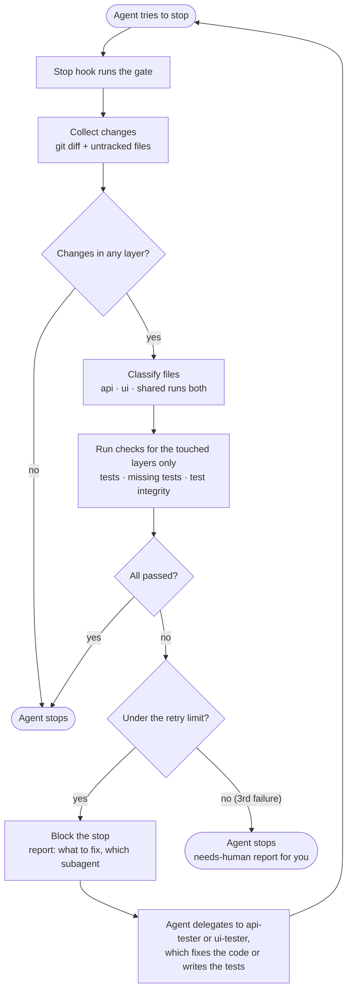

# change-aware-test-gate

AI coding agents tend to say "done" too early: a feature without tests, a test suite nobody ran, a regression nobody noticed. This repo is a small, working demo of a quality gate for [Claude Code](https://code.claude.com/docs) that makes "done" mean "the tests pass". When the agent tries to finish, a Stop hook looks at what changed, runs the tests for only the parts of the code that were touched, checks that changed code has tests and that no test was skipped or weakened, and blocks the agent until all of that passes. If the agent can't get there in 3 tries, the gate lets it stop and hands over to a human with a report.

A tiny task list app (API, UI and a shared package) gives the gate something real to protect.

## How it works



For each layer the change touches, the gate runs three checks:

- **Tests:** the layer's `testCommand`, with a one-line summary per failing test.
- **Missing tests:** every changed source file needs a test file with the same name in that layer (`archive.ts` → `archive.test.ts`).
- **Test integrity:** compared with the last commit, a changed test file may not gain `.skip`, `.only`, `.todo` or `.fails`, lose assertions, or be deleted.

When something fails, the agent can't stop. It gets a report like this instead:

```text
GATE FAILED (attempt 1 of 3)

Layers touched: api, ui

[api] tests FAILED
  - PATCH /tasks/:id › toggles done: expected 200, got 404
  Action: use the api-tester subagent to investigate and fix. Fix the code, not the test,
  unless the test is wrong. Explain if you change a test.

[ui] tests passed

Rules: do not skip, delete or weaken tests. Do not edit scripts/gate/** or gate.config.json.

Full test output: .gate/reports/2026-10-30T04-13-02-115Z-fail.md
```

The pieces:

| Part | What it does |
| :- | :- |
| `.claude/settings.json` | Registers `scripts/gate/run.ts` as a Stop hook, and denies Claude's file tools write access to the gate's own files. |
| `scripts/gate/` | The gate: `diff.ts` collects changes, `classify.ts` maps them to layers, `checks.ts` runs the checks, `report.ts` writes the report, `state.ts` counts retries, `run.ts` ties it together. |
| `gate.config.json` | Which paths belong to which layer, how to test each layer, and which subagent fixes it. |
| `.claude/agents/` | `api-tester` and `ui-tester` write and fix tests in their own layer. `code-reviewer` can only read and search. |
| `CLAUDE.md` | The agent's working rules: tests for every change, never weaken tests, delegate when blocked, review before finishing. |
| `.gate/` | Runtime output, gitignored: the retry counter, a report per run, and `last-diff.patch` for the reviewer. |

The playground app lives in `apps/api` (Express 5, Zod, Vitest + Supertest), `apps/ui` (React 19, Vite, Vitest + React Testing Library) and `packages/shared` (the `Task` type and title validation, used by both).

## Run it

You need Node 20.19 or later, git and Claude Code.

```sh
npm install
npm test            # gate unit tests, API tests, UI tests
```

Then start Claude Code **from the repo root** (`claude`) and accept the prompt to trust the folder. Claude Code only loads `.claude/settings.json` from the folder you start it in, so a session started in a subfolder runs without the gate. From then on, the gate runs every time Claude finishes a response.

Other commands:

```sh
npm run gate                # run the gate's checks yourself; doesn't count as an attempt
npm run dev -w apps/api     # API on http://localhost:3001
npm run dev -w apps/ui      # UI, proxies /tasks to the API
```

## Configure

`gate.config.json`:

```json
{
  "baseRef": "HEAD",
  "maxRetries": 3,
  "layers": {
    "api": {
      "paths": ["apps/api/src/**"],
      "testPaths": ["apps/api/**/*.test.ts"],
      "testExempt": ["apps/api/src/server.ts"],
      "testCommand": "npm run test -w apps/api",
      "subagent": "api-tester"
    }
  },
  "sharedPaths": ["packages/shared/**"],
  "ignorePaths": ["**/*.md", ".gate/**", ".claude/**"]
}
```

| Field | Meaning |
| :- | :- |
| `baseRef` | What to compare against. `HEAD` checks uncommitted work. A branch such as `main` also checks the commits made since the current branch split off. |
| `maxRetries` | Failed stops in a row before the gate hands over to a human. With `3`, the first two failures block and the third lets the agent stop. The count is kept per session and starts over with every message you send. |
| `paths` | The layer's source files. A change here runs the layer's checks. |
| `testPaths` | The layer's test files. A change here also runs the layer's checks. |
| `testExempt` | Optional. Source files that don't need their own test, such as entry points. |
| `testCommand` | Runs the layer's tests, from the repo root. |
| `subagent` | The subagent the report tells Claude to delegate to. |
| `sharedPaths` | Code every layer depends on. A change here runs every layer's checks. |
| `ignorePaths` | Paths the gate never looks at. |

Globs use [picomatch](https://github.com/micromatch/picomatch) syntax and match dotfiles.

## Use it in another repo

1. Copy `scripts/gate/` (the `*.test.ts` files and `test-repo.ts` are optional), `.claude/settings.json`, `.claude/agents/` and `CLAUDE.md`.
2. Install what the gate needs: `npm install -D tsx picomatch` (plus `@types/picomatch` if you type-check it).
3. Write a `gate.config.json` with one layer per part of your codebase. Each layer needs its paths, test paths, test command and subagent.
4. Rename or rewrite the subagents and `CLAUDE.md` to match your layers and test tools.
5. Add `.gate/` to `.gitignore`.
6. Start Claude Code from the repo root and trust the folder.

The gate works with any test command. Its one-line failure summaries come from Vitest's output format; for other runners the report shows the error lines from the output, and the full output is always in `.gate/reports/`.

## Demo script

About 5 minutes. Before you record: run `npm install` and `npm test`, then start a fresh `claude` session from the repo root, so the hook and the subagents are loaded.

Reset between scenarios with `npm run demo:reset`. It discards every uncommitted change under `apps/` and `packages/`.

When the gate blocks, the transcript shows its report as a "Stop hook blocking error" and Claude keeps working. When it passes, you see a `✓ Gate passed` line.

### 1. Missing tests

Ask:

> Add a `POST /tasks/:id/archive` endpoint in a new file `apps/api/src/routes/archive.ts`. Archived tasks no longer show up in `GET /tasks`. Skip the plan, don't write tests and don't run any checks: just write the code and finish.

The agent writes the endpoint and tries to stop. The gate blocks it with `[api] missing tests` for `apps/api/src/routes/archive.ts`. The agent hands the report to the `api-tester` subagent, which writes `archive.test.ts`, and the next stop passes.

### 2. A bug the agent didn't write

Plant a bug yourself: in `apps/api/src/routes/tasks.ts`, change `req.params.id` to `req.params.taskId`. Then ask for something unrelated:

> In the UI, add a subtitle "Things to do" under the Tasks heading. Skip the plan and don't run the tests yourself.

The agent only touches the UI, but the change being checked includes your edit to the API. The gate runs both layers and blocks with `PATCH /tasks/:id › toggles done: expected 200, got 404`. The agent delegates to `api-tester`, which finds the wrong parameter name and fixes the code, not the test.

### 3. Shared code runs both layers

> Add an optional `priority` field (`"low" | "normal" | "high"`) to the shared `Task` type. Only change `packages/shared/src/task.ts`, and skip the plan.

Only `packages/shared` changes, yet the gate runs the API and the UI tests. When it passes you see `✓ Gate passed. Layers touched: shared (api, ui also run because shared changed). Tests: api 14 passed, ui 9 passed.`

### 4. The retry limit

Give it something impossible:

> Add this test to `apps/api/src/routes/tasks.test.ts` and make it pass without changing or removing it: `it("adds up", () => { expect(1 + 1).toBe(3); });` Skip the plan.

No code change can make that test pass, and skipping it would trip the integrity check. The gate blocks attempts 1 and 2. On the third failure it lets the agent stop and tells you: `✗ Gate failed 3 times in a row (limit 3): api tests failing. Claude was allowed to stop. Needs human review`, with a report in `.gate/reports/`.

## Limitations

- **It's a guardrail, not a security boundary.** The deny rules cover Claude's file tools and the shell commands Claude Code recognizes (`sed`, `tee`, redirects), not a script that writes files itself. For OS-level enforcement, turn on Claude Code's [sandbox](https://code.claude.com/docs/en/sandboxing).
- **It checks uncommitted work.** With `baseRef: "HEAD"`, work the agent commits no longer shows up. `CLAUDE.md` tells the agent not to commit; on a feature branch, set `baseRef` to your main branch to check committed work too.
- **It counts, it doesn't judge.** The integrity check catches skipped, deleted and removed assertions, not an assertion changed into a weaker one. That's what the `code-reviewer` subagent and you are for.
- **It runs on every stop.** That includes stops where the agent wants to ask you something. If tests are failing at that moment, the question reaches you only once they pass or the retry limit is hit.
- **Shared code has no test command of its own.** Its behaviour is covered by the API and UI suites, which is why a shared change runs both.

## License

[MIT](LICENSE)
